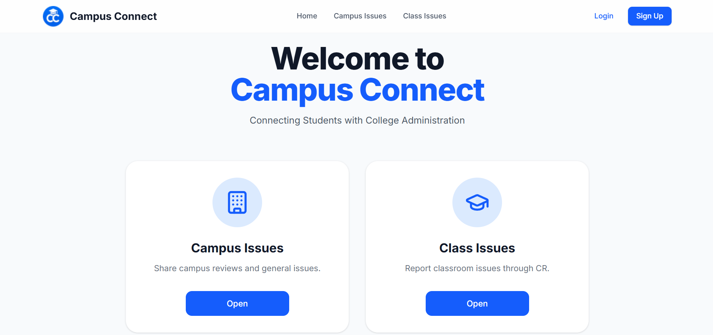
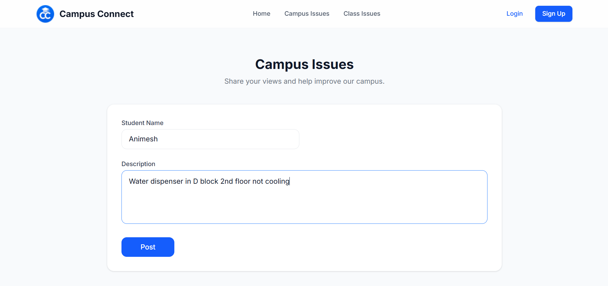
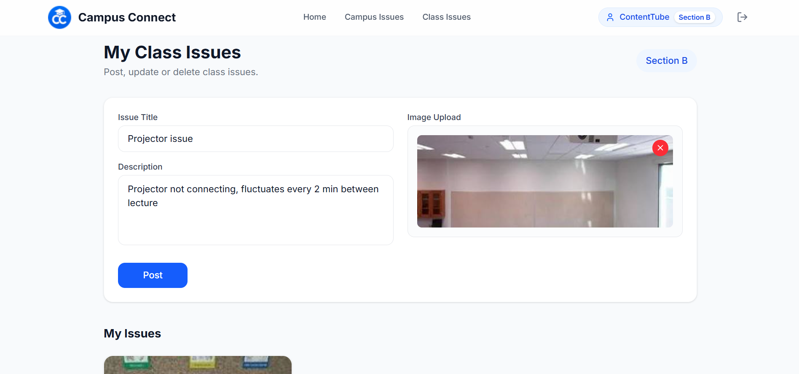
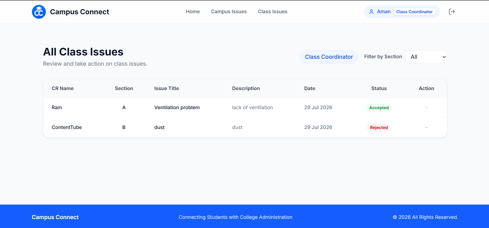

<h1 align="center">🎓 Campus Connect</h1>

<p align="center">
  
</p>

<p align="center">
  A modern web platform to manage and report campus and classroom issues efficiently.
</p>

---

## 🚀 Live Demo
🔗 https://campus-connect-ten-ochre.vercel.app/

---

## 📌 Problem Statement

In many colleges, students face issues like:

- Infrastructure problems 🏫  
- Classroom complaints 📚  
- Communication gaps with faculty 👨‍🏫  

**Campus Connect** solves this by providing a centralized platform where:

- Students can report issues  
- CRs can manage class problems  
- Faculty can monitor and respond  

---

## ✨ Features

### 👨‍🎓 Student
- Raise complaints
- Upload images
- Track issue status

### 🧑‍🏫 CR (Class Representative)
- Manage class-specific issues
- Monitor submissions
- Organized dashboard

### 👨‍🏫 Faculty
- View all issues
- Respond and take action
- Analytics dashboard

---

## 🖼️ Screenshots


### 📊 Campus Issues



### 📊 CR Dashboard



### 📊 Faculty Dashboard



---

## 🛠️ Tech Stack

- ⚛️ React + TypeScript  
- 🎨 Tailwind CSS  
- 🔥 Supabase (Auth + Database + Storage)  
- ⚡ Vite  

---

## 🔐 Authentication & Security

- Supabase Authentication  
- Role-based access control  
- Row Level Security (RLS)  

---

## ⚙️ Installation

```bash
git clone https://github.com/your-username/campus-connect.git
cd campus-connect
npm install
